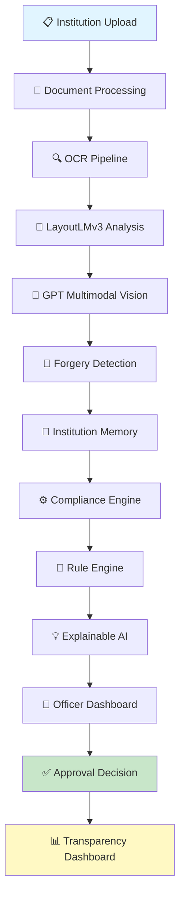

# Zavyfy

<div align="center">


**An intelligent decision support platform transforming AICTE approval workflows with explainable AI, real-time compliance verification, and institutional memory.**


</div>

---

## 📌 Overview

**Zavyfy** is an AI-powered decision support system designed to revolutionize how AICTE (All India Council for Technical Education) officers validate institutional applications. This platform combines cutting-edge AI, document intelligence, and compliance automation to accelerate approvals while maintaining the highest standards of regulatory compliance and fraud detection.

### 🎯 Problem Statement

AICTE processes thousands of institutional approval applications annually—Extension of Approval (EoA), New Institution Approval, Course Approvals, and more. Current workflows face critical challenges:

- **Manual Document Verification**: Officers spend hours manually reviewing PDFs, certificates, and compliance documents
- **Inconsistency**: Lack of standardized decision criteria across multiple reviewers
- **Fraud Risk**: Forged documents and inconsistent institutional data go undetected
- **Slow Processing**: Approval timelines extend due to manual document analysis
- **No Institutional Memory**: Repeated queries and information gaps across applications
- **Limited Transparency**: Institutions lack clarity on approval status and requirements

### ✨ Key Innovations

| Innovation | Description | Impact |
|-----------|-------------|--------|
| **🔍 Verified Site Evidence** | Multi-source institutional data validation combining official records, website verification, and location intelligence | Eliminates manual site verification; detects location mismatches |
| **🧠 Institution Memory** | Persistent knowledge graph tracking institutional history, previous applications, violations, and amendments | Enables context-aware decisions; prevents repeated violations |
| **🆔 DigiLocker Verification** (Proposed) | Direct integration with NSDL DigiLocker for authentic certificate validation | Government-grade document authenticity verification |
| **📡 Rule Change Radar** | Real-time monitoring and adaptation to regulatory updates (AICTE rules, UGC guidelines) | Ensures decisions align with current regulations |
| **📊 Smart Inspection Prioritiser** | AI-driven risk scoring for on-site inspections | Optimizes inspection resource allocation |
| **🎓 Explainable AI** | Transparent reasoning for every AI recommendation with evidence trails | Builds trust; satisfies audit requirements |
| **🗣️ Bhashini Integration** | Multilingual document processing and communication | Supports regional institutions; improves accessibility |
| **✅ Institution Pre-check** | Automated preliminary validation before formal application submission | Reduces invalid submissions; improves first-pass success rate |
| **🔁 Appeal Mechanism** | Structured process for institutions to challenge AI findings with human review | Ensures fairness; provides recourse |
| **☁️ Government Cloud Ready** | Architecture compliant with NIC/MeitY cloud standards | Enterprise-grade security and compliance |
| **📈 Public Transparency Dashboard** | Public portal for institutional approval status and statistics | Enhances accountability and trust |

---

## 🏗️ Architecture



### System Components

#### **Frontend Layer** ✅ (Currently Implemented)
- **React + TypeScript**: Modern, type-safe UI development
- **Vite**: Lightning-fast build and development server
- **TailwindCSS + shadcn/ui**: Professional, accessible component library
- **Framer Motion**: Smooth animations and transitions
- **TanStack Router**: Type-safe client-side routing
- **TanStack Query**: Efficient data fetching and caching
- **React Hook Form + Zod**: Robust form validation
- **Recharts**: Interactive data visualization

#### **Backend Layer** 🚧 (Planned)
- **FastAPI**: High-performance Python web framework
- **LangGraph**: Orchestration for multi-agent AI workflows
- **Redis**: Real-time caching and queue management
- **PostgreSQL + pgvector**: Relational data + vector similarity search
- **S3-compatible Storage**: Document and evidence archival

#### **AI/ML Pipeline** 🚧 (Planned)
- **docTR + Tesseract**: Optical character recognition (OCR)
- **LayoutLMv3**: Document layout understanding
- **GPT-5-class Multimodal**: Vision and language understanding
- **OpenCV**: Image processing and forensic analysis
- **ClamAV**: Malware detection in uploaded documents
- **Langfuse**: AI observability and monitoring
- **LangChain**: LLM framework for agent orchestration

---

## 📊 Technology Stack

### Frontend (✅ Implemented)

| Technology | Purpose | Why Chosen |
|-----------|---------|-----------|
| **React 18** | UI framework | Industry standard; component-based architecture |
| **TypeScript** | Type safety | Prevents runtime errors; improves developer experience |
| **Vite** | Build tool | 10x faster than Webpack; instant HMR |
| **TailwindCSS** | Styling | Utility-first; rapid development; responsive design |
| **shadcn/ui** | Components | Accessible; customizable; production-ready |
| **Framer Motion** | Animations | Declarative; performance-optimized |
| **TanStack Router** | Routing | Type-safe; supports deep linking and async data |
| **TanStack Query** | Data fetching | Automatic caching; request deduplication |
| **React Hook Form** | Forms | Minimal re-renders; excellent performance |
| **Zod** | Validation | TypeScript-native schema validation |
| **Recharts** | Charts | React-native; composable; accessible |
| **Lucide React** | Icons | 400+ consistent, accessible icons |
| **Axios** | HTTP client | Simple, promise-based API calls |

### Backend (🚧 Planned)

| Technology | Purpose | Why Chosen |
|-----------|---------|-----------|
| **FastAPI** | Web framework | Async-first; auto API docs; blazing fast |
| **LangGraph** | Agent orchestration | Structured multi-agent workflows; state persistence |
| **PostgreSQL** | Database | Relational integrity; ACID compliance; pgvector extension |
| **pgvector** | Vector search | Native vector similarity for AI embeddings |
| **Redis** | Cache/Queue | Sub-millisecond response times; pub/sub for real-time |
| **S3 Compatible** | File storage | Scalable; industry-standard; encryption support |
| **docTR** | OCR | State-of-the-art document text extraction |
| **LayoutLMv3** | Document understanding | Layout-aware document analysis |
| **OpenCV** | Image processing | Forensic analysis; tamper detection |
| **ClamAV** | Malware detection | Open-source AV engine |
| **Langfuse** | LLM monitoring | Trace & debug AI agents; cost monitoring |

---

## 📁 Project Structure

```
aicte-approval-intelligence/
├── frontend/                    # ✅ React/Vite frontend (implemented)
│   ├── src/
│   │   ├── components/         # Reusable React components
│   │   │   ├── Dashboard/      # KPI cards, charts, widgets
│   │   │   ├── Applications/   # Application list, detail views
│   │   │   ├── OfficerPanel/   # Officer workspace
│   │   │   ├── AIWorkflow/     # 8-agent processing pipeline UI
│   │   │   ├── Compliance/     # Compliance center
│   │   │   ├── Memory/         # Institution memory explorer
│   │   │   └── Common/         # Buttons, modals, headers
│   │   ├── pages/              # Page-level components
│   │   ├── hooks/              # Custom React hooks
│   │   ├── context/            # Global state (auth, theme)
│   │   ├── services/           # API client functions
│   │   ├── types/              # TypeScript interfaces
│   │   ├── utils/              # Helpers, formatters
│   │   ├── styles/             # Global CSS
│   │   └── main.jsx            # Entry point
│   ├── index.html
│   ├── package.json
│   └── vite.config.js
│
├── backend/                     # 🚧 FastAPI backend (planned)
│   ├── app/
│   │   ├── api/                # REST endpoints
│   │   │   ├── applications.py
│   │   │   ├── documents.py
│   │   │   ├── compliance.py
│   │   │   ├── findings.py
│   │   │   └── inspection.py
│   │   ├── agents/             # AI agents (LangGraph)
│   │   ├── models/             # Pydantic models
│   │   ├── db/                 # Database layer
│   │   └── core/               # Config, auth, logging
│   ├── main.py
│   ├── requirements.txt
│   └── .env.example
│
├── agents/                      # 🚧 LangGraph orchestration (planned)
│   ├── ocr_agent.py
│   ├── document_agent.py
│   ├── vision_agent.py
│   ├── forgery_agent.py
│   ├── compliance_agent.py
│   ├── memory_agent.py
│   ├── rule_engine.py
│   └── explainability_agent.py
│
├── database/                    # 🚧 Schema & migrations (planned)
│   ├── schema.sql
│   ├── migrations/
│   └── seeds/
│
├── storage/                     # 🚧 S3 configuration (planned)
│   └── upload_handler.py
│
├── docs/                        # Documentation
│   ├── API.md
│   ├── ARCHITECTURE.md
│   ├── AGENTS.md
│   └── DEPLOYMENT.md
│
└── README.md                    # This file
```

---

## ✅ Frontend Features (Currently Implemented)

### 1. **Executive Dashboard**
- Real-time KPI cards (Total Applications, Pending Review, Approved, Rejected)
- Interactive trend charts (application status over time)
- Risk distribution heatmap
- Compliance summary by institution type
- Document verification status tracker

### 2. **Application Management**
- Searchable application registry with advanced filters
- Multi-column sorting (status, priority, date, compliance score)
- Multi-select bulk actions
- CSV export of filtered results
- Quick status overview (Submitted, Under Review, Approved, Rejected, Appeal)

### 3. **Application Detail View**
Multi-tab interface for comprehensive application review:
- **Overview**: Basic information, institution details, application type
- **Documents**: Uploaded files with preview, verification status, OCR readiness indicators
- **Infrastructure**: Facilities, labs, library resources, accommodation
- **Faculty**: Faculty qualifications, experience, department mapping
- **Compliance**: Regulatory checklist, standards compliance, self-certification
- **AI Findings**: Automated detection results with severity and confidence scores
- **Institution Memory**: Historical data, previous applications, violations, amendments
- **Timeline**: Application status progression with timestamps
- **Audit Logs**: Complete action history for transparency

### 4. **AI Processing Workflow UI**
- Animated 8-stage processing pipeline visualization
- Real-time status updates for each AI agent
- Progress indicators and time estimates
- Failure handling and retry mechanisms
- Detailed agent logs and reasoning traces

### 5. **Evidence-Linked AI Findings**
- Structured findings with evidence references
- Severity levels (Critical, High, Medium, Low, Info)
- Confidence scores with calibration
- Rule references and regulatory citations
- Contextual recommendations for officers
- Appeal/challenge interface

### 6. **Compliance Center**
- Regulatory requirement checklist
- Compliance status aggregation
- Rule version tracking
- Historical compliance snapshots
- Non-compliance risk indicators

### 7. **Institution Memory**
- Knowledge graph visualization
- Historical application tracking
- Previous violations and amendments
- Institutional patterns and trends
- Memory search and filtering

### 8. **Smart Inspection Interface**
- Risk-prioritized inspection queue
- Scheduling and resource allocation
- On-site finding capture
- Photo/evidence upload
- Integration with findings workflow

### 9. **Analytics & Reports**
- Application funnel analysis
- Approval rate by institution type
- Processing time metrics
- Risk distribution trends
- Export to PDF/Excel

### 10. **Officer Workspace**
- Personal dashboard with assigned applications
- Priority queue management
- Notes and comments
- Recommendation tracking
- Workload distribution view

### 11. **Responsive Design**
- Mobile-first responsive layout
- Touch-optimized interactions
- Dark/Light mode toggle
- Adaptive typography and spacing

### 12. **Accessibility & UX**
- Command palette (Ctrl/Cmd + K)
- Toast notifications for feedback
- Profile menu with settings
- Notification center
- Keyboard navigation support

---

## 🚧 Backend Features (Planned)

### Document Processing
- [ ] OCR pipeline with confidence scoring
- [ ] Multi-format support (PDF, images, DOC)
- [ ] Batch processing capability
- [ ] Language detection and multi-language OCR

### Vision & Forgery Detection
- [ ] Document tampering detection
- [ ] Signature/stamp verification
- [ ] QR code validation
- [ ] Hologram authentication checks

### Compliance Engine
- [ ] Rule engine for regulatory checks
- [ ] Dynamic rule loading and versioning
- [ ] Compliance report generation
- [ ] Exception handling and escalation

### Institution Memory
- [ ] Knowledge graph construction
- [ ] Semantic search capabilities
- [ ] Similarity matching for pattern detection
- [ ] Risk scoring based on history

### Government Integrations
- [ ] DigiLocker verification API
- [ ] API Setu for GSTN data
- [ ] Location verification services
- [ ] Bhashini for multilingual support

### Explainable AI
- [ ] Decision tree visualization
- [ ] Evidence chains for recommendations
- [ ] Reasoning explanation generation
- [ ] Model prediction transparency

---

## 🤖 AI Agents (Backend Architecture)

### Agent Workflow Overview


### Individual Agents

#### 1. **OCR Agent** 🔍
**Purpose**: Extract text from documents with high accuracy
- Supports: PDF, JPG, PNG, TIFF, DOC
- Output: Text extraction, confidence scores, bounding boxes
- Technology: docTR, Tesseract
- Confidence threshold: 85%+

#### 2. **Document Understanding Agent** 📄
**Purpose**: Classify and extract structured information
- Recognizes: Certificates, transcripts, infrastructure reports, compliance documents
- Extracts: Key-value pairs, tables, lists
- Technology: LayoutLMv3
- Output: Structured JSON with confidence

#### 3. **Vision Agent** 👁️
**Purpose**: Analyze visual content for compliance
- Validates: Photo signatures, institutional logos, official seals
- Checks: Document authenticity indicators
- Technology: GPT-5-class Multimodal, OpenCV
- Output: Verification status, confidence

#### 4. **Forgery Detection Agent** 🚨
**Purpose**: Detect tampered, forged, or fraudulent documents
- Detects: Altered dates, inserted content, clone stamps
- Flags: Inconsistent metadata, pixel-level anomalies
- Technology: OpenCV, ClamAV (for malware), statistical analysis
- Output: Risk score, anomaly locations, recommendations

#### 5. **Compliance Agent** ⚙️
**Purpose**: Validate regulatory requirements
- Checks: Mandatory document presence, content accuracy
- Validates: Faculty qualifications, infrastructure standards, affiliation requirements
- Output: Compliance matrix, gaps, risk assessment

#### 6. **Institution Memory Agent** 🧠
**Purpose**: Leverage historical institutional data
- Retrieves: Previous applications, violations, amendments
- Identifies: Patterns, repeat violations, trends
- Searches: Semantic similarity across applications
- Output: Context, risk factors, precedents

#### 7. **Rule Engine** 📐
**Purpose**: Apply regulatory rules dynamically
- Parses: AICTE EoA rules, UGC guidelines, state regulations
- Evaluates: Complex conditions and approval criteria
- Supports: Rule versioning and temporal rules
- Output: Applicable rules, satisfaction status

#### 8. **Explainability Agent** 💡
**Purpose**: Generate human-readable explanations
- Traces: Decision logic with evidence
- Generates: Recommendation reasoning
- Creates: Audit trails for transparency
- Output: Narrative explanation, evidence links, confidence breakdown

#### 9. **Risk Assessment Agent** (Synthesis)
**Purpose**: Synthesize all agent outputs into risk score
- Aggregates: Individual agent confidence scores
- Weighs: Evidence priority and reliability
- Calculates: Overall institutional risk
- Output: Risk category (Green/Yellow/Red), recommendations

---

## 💾 Database Design (Planned)

```sql
-- Core Tables

CREATE TABLE institutions (
    id UUID PRIMARY KEY,
    aicte_code VARCHAR UNIQUE,
    name VARCHAR NOT NULL,
    location POINT,
    established_year INT,
    institution_type VARCHAR,
    state_code VARCHAR,
    created_at TIMESTAMP,
    updated_at TIMESTAMP
);

CREATE TABLE applications (
    id UUID PRIMARY KEY,
    institution_id UUID REFERENCES institutions,
    application_type VARCHAR,
    status VARCHAR,
    submitted_at TIMESTAMP,
    decision_at TIMESTAMP,
    risk_score FLOAT,
    created_at TIMESTAMP
);

CREATE TABLE documents (
    id UUID PRIMARY KEY,
    application_id UUID REFERENCES applications,
    document_type VARCHAR,
    file_path VARCHAR,
    ocr_text TEXT,
    forgery_score FLOAT,
    verification_status VARCHAR,
    created_at TIMESTAMP
);

CREATE TABLE findings (
    id UUID PRIMARY KEY,
    application_id UUID REFERENCES applications,
    agent_type VARCHAR,
    severity VARCHAR,
    confidence_score FLOAT,
    evidence TEXT,
    recommendation TEXT,
    created_at TIMESTAMP
);

CREATE TABLE rules (
    id UUID PRIMARY KEY,
    rule_code VARCHAR,
    description TEXT,
    applicable_from DATE,
    applicable_to DATE,
    rule_version INT,
    content JSONB
);

CREATE TABLE institution_memory (
    id UUID PRIMARY KEY,
    institution_id UUID REFERENCES institutions,
    memory_type VARCHAR,
    content JSONB,
    embedding vector(1536),
    created_at TIMESTAMP
);

CREATE TABLE inspection_records (
    id UUID PRIMARY KEY,
    application_id UUID REFERENCES applications,
    inspection_date DATE,
    inspector_id UUID,
    findings TEXT,
    photos JSONB,
    status VARCHAR
);

CREATE TABLE audit_logs (
    id UUID PRIMARY KEY,
    application_id UUID REFERENCES applications,
    action VARCHAR,
    actor_id UUID,
    details JSONB,
    created_at TIMESTAMP
);
```

---

## 🔌 API Design (Planned)

### Base URL
```
https://api.aicte-approval.gov.in/v1
```

### Authentication
```
Authorization: Bearer <JWT_TOKEN>
```

### Key Endpoints

#### Applications
```http
POST /applications
  Create new application
  
GET /applications
  List applications with filters
  
GET /applications/{id}
  Get application details
  
PATCH /applications/{id}
  Update application status
  
POST /applications/{id}/findings
  Get AI findings
```

#### Documents
```http
POST /applications/{id}/documents
  Upload document for OCR/verification
  
GET /applications/{id}/documents
  List documents
  
GET /documents/{id}/verify
  Verify document authenticity
```

#### Compliance
```http
GET /compliance/{application_id}
  Get compliance status
  
POST /compliance/{application_id}/validate
  Run compliance validation
```

#### Inspection
```http
POST /inspection
  Schedule inspection
  
POST /inspection/{id}/findings
  Submit inspection findings
  
GET /inspection/{id}/report
  Get inspection report
```

#### Institution Memory
```http
GET /institutions/{id}/memory
  Query institution memory
  
POST /institutions/{id}/memory
  Add to memory
```

### Example Request/Response

```bash
# Request
curl -X GET "https://api.aicte-approval.gov.in/v1/applications?status=PENDING&limit=10" \
  -H "Authorization: Bearer eyJ0eXAi..."

# Response
{
  "data": [
    {
      "id": "app-123",
      "institution_id": "inst-456",
      "status": "PENDING_REVIEW",
      "risk_score": 0.35,
      "submitted_at": "2026-01-15T10:30:00Z",
      "documents_uploaded": 12,
      "findings_count": 3,
      "compliance_score": 0.92
    }
  ],
  "pagination": {
    "total": 1543,
    "page": 1,
    "limit": 10
  }
}
```

---

## 🚀 Quick Start

### Prerequisites
- **Node.js 18+** (for frontend development)
- **Python 3.10+** (for backend development - planned)
- **PostgreSQL 14+** (for database - planned)
- **Git**

### Frontend Installation & Setup

#### 1. Clone Repository
```bash
git clone https://github.com/your-org/aicte-approval-intelligence.git
cd aicte-approval-intelligence/frontend
```

#### 2. Install Dependencies
```bash
npm install
```

#### 3. Set Up Environment Variables
```bash
# Copy example env file
cp .env.example .env.local

# Edit with your configuration
# VITE_API_BASE_URL=http://localhost:8000
# VITE_AUTH_ENABLED=false (for demo)
```

#### 4. Run Development Server
```bash
npm run dev
```
The frontend will be available at `http://localhost:5173`

#### 5. Build for Production
```bash
npm run build
npm run preview
```

### Backend Installation (Planned)

```bash
cd backend

# Create virtual environment
python -m venv venv
source venv/bin/activate  # or `venv\Scripts\activate` on Windows

# Install dependencies
pip install -r requirements.txt

# Set up environment
cp .env.example .env
# Edit .env with your configuration

# Run migrations
alembic upgrade head

# Start server
uvicorn main:app --reload
```


## 📊 Implementation Status

| Component | Status | Progress | ETA |
|-----------|--------|----------|-----|
| **Frontend UI** | ✅ Complete | 100% | — |
| **Component Library** | ✅ Complete | 100% | — |
| **Dark Mode** | ✅ Complete | 100% | — |
| **Responsive Design** | ✅ Complete | 100% | — |
| **Backend API** | 🚧 In Progress | 0% | Q2 2026 |
| **Database Schema** | 🚧 Planned | 0% | Q2 2026 |
| **OCR Pipeline** | 🚧 Planned | 0% | Q2 2026 |
| **AI Agents** | 🚧 Planned | 0% | Q3 2026 |
| **Rule Engine** | 🚧 Planned | 0% | Q3 2026 |
| **Explainability** | 🚧 Planned | 0% | Q3 2026 |
| **Government Integration** | 🚧 Planned | 0% | Q4 2026 |
| **Production Deployment** | 🚧 Planned | 0% | Q4 2026 |

---

## 🔮 Future Roadmap

### Phase 1: Frontend Excellence ✅ (Current - Complete)
- [x] Beautiful, responsive dashboard
- [x] Multi-view application management
- [x] AI workflow visualization
- [x] Compliance tracking interface
- [x] Accessibility & dark mode support

### Phase 2: Backend Foundation 🚧 (Q2 2026)
- [ ] FastAPI server setup
- [ ] PostgreSQL database with migrations
- [ ] Authentication & authorization
- [ ] Document upload & storage
- [ ] Basic REST API endpoints
- [ ] Redis caching layer

### Phase 3: AI & Document Processing 🚧 (Q3 2026)
- [ ] OCR pipeline (docTR + Tesseract)
- [ ] LayoutLMv3 document classification
- [ ] GPT-5 multimodal vision analysis
- [ ] Forgery detection engine
- [ ] LangGraph agent orchestration
- [ ] Institution memory implementation

### Phase 4: Intelligence & Automation 🚧 (Q3 2026)
- [ ] Compliance rule engine
- [ ] Risk assessment and scoring
- [ ] Explainable AI framework
- [ ] Smart inspection prioritization
- [ ] Institution pre-check automation

### Phase 5: Government Integration 🚧 (Q4 2026)
- [ ] DigiLocker API integration
- [ ] Bhashini multilingual support
- [ ] API Setu GSTN verification
- [ ] Government cloud deployment
- [ ] Public transparency dashboard

### Phase 6: Production Readiness 🚧 (Q4 2026)
- [ ] Security audit & penetration testing
- [ ] Performance optimization
- [ ] Load testing & scaling
- [ ] Comprehensive documentation
- [ ] Training & onboarding
- [ ] Live production deployment

---

## 🛠️ Development Guide

### Development Commands

```bash
# Frontend
npm run dev          # Start dev server
npm run build        # Production build
npm run preview      # Preview production build
npm run lint         # Run ESLint
npm run format       # Format code with Prettier
npm run type-check   # TypeScript type checking

# Backend (when available)
python -m pytest     # Run tests
uvicorn main:app    # Start server
```

### Code Structure Conventions

```
src/
├── components/      # Reusable React components
├── pages/          # Page-level components
├── hooks/          # Custom React hooks
├── context/        # Global state
├── services/       # API clients, utilities
├── types/          # TypeScript types
└── styles/         # Global styles
```

### Git Workflow

```bash
# Create feature branch
git checkout -b feature/feature-name

# Make changes and commit
git add .
git commit -m "feat: description"

# Push and create PR
git push origin feature/feature-name
```

---

## ⚠️ Important Demo Notice

**⚠️ FRONTEND-ONLY IMPLEMENTATION**

This repository currently contains **only the frontend React application**. The platform does **NOT** have a connected backend and does **NOT** perform real AICTE operations.

### What This Means:

✅ **Fully Functional Frontend**
- Beautiful, responsive user interface
- Complete UI for all workflows
- Realistic demo data and scenarios
- Dark/light mode, accessibility, animations

❌ **NOT Implemented (Backend)**
- No real document processing
- No actual AI analysis
- No database persistence
- No real AICTE API integration
- No actual approval decisions

### Data in This Application

All institution records, applications, AI findings, compliance data, and audit logs are **illustrative demo data**. They do not represent real institutions or applications.

### Before Production Use

To deploy this as a real AICTE approval system, you must:

1. **Build the Backend**
   - Implement FastAPI server with endpoints
   - Set up PostgreSQL database with proper migrations
   - Implement authentication and authorization

2. **Integrate AI Pipeline**
   - Deploy OCR and document processing
   - Configure LangGraph agents
   - Validate AI model quality and accuracy

3. **Implement Security**
   - Secure API authentication (OAuth2/OIDC)
   - Data encryption at rest and in transit
   - Regular security audits and penetration testing
   - Document security compliance (ISO 27001)

4. **Validate Regulatory Compliance**
   - Ensure rules match current AICTE guidelines
   - Implement audit logging for all decisions
   - Maintain human oversight and appeal mechanisms
   - Comply with NIC/MeitY cloud standards

5. **Government Integration**
   - Connect to official AICTE systems
   - Integrate DigiLocker, API Setu
   - Implement proper data governance

